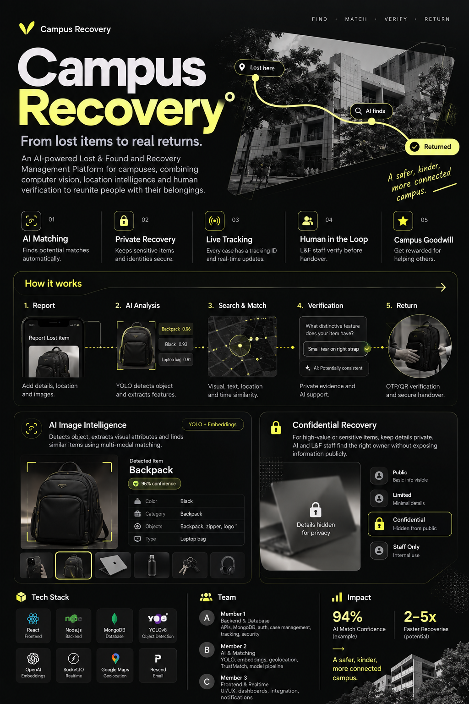

# 🚀 CampusFind AI

## Smart Campus Lost & Found System


An AI-powered full-stack campus Lost & Found platform that helps students report, search, match and recover lost items securely.

Built with **React, TypeScript, Vite, Tailwind CSS, Python, FastAPI, SQLAlchemy, PostgreSQL, scikit-learn and Docker**.

---

## 📖 Overview

CampusFind AI replaces informal, manual lost-and-found processes (notice boards, group chats, a desk drawer) with one centralized campus platform.

**Students can**
- Register and log in
- Report lost items and found items
- Upload images
- Search and filter items
- Receive AI-powered potential matches
- Submit ownership claims
- Track recovery status

**Administrators can**
- Review reports and approve or reject them
- Review ownership claims and verify the claimant's information
- Mark items as returned
- View statistics and recent activity

---

## ✨ Features

### 🔐 Authentication
- JWT authentication
- bcrypt password hashing
- Protected routes (frontend) and protected endpoints (backend)
- Role-based authorization with `STUDENT`, `FACULTY`, `STAFF` and `ADMIN` roles (self-registration cannot create an admin)

### 📦 Lost & Found
- Report lost items and found items
- Edit and delete your own reports (admins can manage all reports)
- Keyword search plus filters for type, category, brand, colour, location, date and status
- Item status tracking: `ACTIVE → MATCHED → CLAIMED → RETURNED` (or `CLOSED`)
- Progress timeline on every item page

### 📸 Image Upload
- JPEG, PNG and WEBP only
- File size validation (default 15 MB, configurable with `MAX_UPLOAD_MB`)
- The real file content is checked, not just the declared type
- Uploaded images are shown on cards, item pages and match cards

### 🤖 AI Matching

When you view a **lost** item the system looks for similar **found** items, and vice versa. The current implementation is a lightweight, transparent, local algorithm (no external AI service):

- **TF-IDF text similarity** (scikit-learn) on the title and description
- **Weighted structured attributes**: category, brand, colour, location and date proximity

| Signal | Weight |
| --- | --- |
| Title (TF-IDF cosine) | 20% |
| Description (TF-IDF cosine) | 25% |
| Category (exact match) | 15% |
| Brand (exact match) | 10% |
| Colour (exact match) | 10% |
| Location (exact match) | 10% |
| Date proximity (linear decay over 14 days) | 10% |

Candidates scoring below 50 are not shown. The result is presented as a **Match Score**, not a probability, together with the matching attributes and a plain-language explanation.

```text
GET /api/items/{item_id}/matches
```

Example: seeded *Black Dell Laptop* (lost) → *Black Dell Laptop* (found) → **89% Match Score**
(same category, brand, colour, location, similar title and description, close dates).

> The matching uses TF-IDF and weighted attributes only. It does **not** use computer vision, deep learning, sentence-transformers or OpenCV.

### 🔒 Private / Sensitive Reports

Some valuable or sensitive items, such as jewellery, expensive electronics or important documents, may not need to be announced publicly. A reporter can mark a report as **PRIVATE** when creating or editing it, and it is shown with a 🔒 PRIVATE badge.

- Private reports are hidden from public listings and search.
- The owner can access their private report (and sees it under *My Items*).
- Administrators can access private reports (they appear in a *Private Reports* section of the admin dashboard).
- Other students cannot access a private report: the API answers `403` (or `401` when not logged in).
- Private reports still take part in AI matching, but only for viewers who are allowed to see them. Other users never see the private report, and it does not influence the scores they see.
- Authorization is enforced on the **FastAPI backend**, not only in the frontend.

> Limitation: the uploaded image file itself is served by a static mount without separate authentication. See Limitations.

---

## 🔄 Workflow

```text
Student Reports Lost Item
        ↓
Image Upload
        ↓
PostgreSQL Storage
        ↓
AI Matching
        ↓
Potential Match
        ↓
Ownership Claim
        ↓
Admin Verification
        ↓
Claim Approved
        ↓
Item Returned
```

The AI only **suggests** a potential match. Final ownership verification happens through the claim and administrator process: the claimant describes an identifying feature, and the admin compares it with the private details recorded on the found report before approving.

---

## 🏗 Architecture

```text
React + TypeScript + Tailwind
        ↓
Axios / REST API
        ↓
Python + FastAPI
        ↓
SQLAlchemy
        ↓
PostgreSQL
```

```text
FastAPI
   ├── Authentication
   ├── Lost & Found APIs
   ├── Claims
   ├── Admin APIs
   ├── Uploads
   └── AI Matching   (TF-IDF + weighted attribute similarity)
```

AI matching path:

```text
FastAPI  →  ML matching module (ml/)  →  TF-IDF + weighted attribute similarity
```

- **Frontend:** a React + TypeScript single-page app styled with Tailwind CSS. A small API service layer (Axios) handles auth tokens and normalizes API errors.
- **API layer:** FastAPI exposes REST endpoints, validates requests with Pydantic and applies authentication and authorization on every protected route.
- **Data layer:** SQLAlchemy models (users, items, claims) stored in PostgreSQL.
- **AI matching:** a separate Python package (`ml/`) that the API calls to score lost/found pairs. It has no web or database code, so it can be tested on its own.

---

## 🧰 Technology Stack

**Frontend:** React, TypeScript, Vite, Tailwind CSS, React Router, Axios
**Backend:** Python, FastAPI, Pydantic, SQLAlchemy, JWT (python-jose), bcrypt, Pillow (image validation)
**Database:** PostgreSQL 16
**AI / ML:** scikit-learn, TF-IDF, weighted similarity matching
**DevOps:** Docker, Docker Compose, Git
**Testing:** Pytest (backend), Vitest and React Testing Library (frontend)

---

## 📚 API Documentation

FastAPI generates **Swagger UI** automatically. Swagger is FastAPI's interactive API documentation and testing interface: you can read every endpoint's request/response format and try calls directly in the browser. When you run the project locally it is available at:

**http://localhost:8000/docs** (local only; it is not publicly hosted)

| Method | Endpoint | Purpose |
| --- | --- | --- |
| GET | `/api/health` | Health check (includes database status) |
| POST | `/api/auth/register` | Create a student / faculty / staff account |
| POST | `/api/auth/login` | Log in and receive a JWT |
| GET | `/api/auth/me` | Current user |
| POST | `/api/items` | Report a lost or found item |
| GET | `/api/items` | Search and filter public items |
| GET | `/api/items/{item_id}` | Item details (private reports: owner/admin only) |
| GET | `/api/items/{item_id}/matches` | AI potential matches for an item |
| POST | `/api/items/{item_id}/claim` | Submit an ownership claim on a found item |
| GET | `/api/claims` | Your claims (admins see all) |
| PATCH | `/api/claims/{claim_id}/status` | Approve / reject a claim (admin) |
| GET | `/api/admin/stats` | Dashboard statistics (admin) |
| GET | `/api/admin/pending-items` | Reports awaiting review (admin) |
| GET | `/api/admin/activity` | Recent activity (admin) |
| POST | `/api/uploads` | Upload an image (JPEG / PNG / WEBP) |

Other endpoints include `PUT`/`DELETE /api/items/{item_id}`, `PATCH /api/items/{item_id}/status`, `GET /api/users/me/items` and `PATCH /api/admin/items/{item_id}/approval`.

---

## 🧪 Testing

| Suite | Result |
| --- | --- |
| Backend (Pytest) | 24 tests passing |
| Frontend (Vitest + React Testing Library) | 17 tests passing |
| TypeScript check (`tsc`) | clean |
| Vite production build | clean |

The tests cover authentication, authorization, item create/read/update/delete, image uploads (type, size and content validation), AI matching, the claim workflow, private-report visibility and admin functionality.

```bash
# backend (the tests use an in-memory database, no PostgreSQL needed)
cd backend && python3 -m venv .venv && .venv/bin/pip install -r requirements-dev.txt && cd ..
backend/.venv/bin/pytest tests

# frontend
cd frontend && npm install
npm test
npx tsc -b
npm run build
```

---

## 🖼 Screenshots

Screenshots are added manually (see [`screenshots/README.md`](screenshots/README.md)). Each section below shows its image once the file exists in `screenshots/`: uncomment the image line after adding it.

### 🏠 Home Page
<!--  -->
_Screenshot to be added: `screenshots/home.png`_

### 📝 Lost Item Report
<!--  -->
_Screenshot to be added: `screenshots/lost-report.png`_

### 📦 Found Item Report
<!--  -->
_Screenshot to be added: `screenshots/found-report.png`_

### 🤖 AI Matching
<!--  -->
_Screenshot to be added: `screenshots/ai-match.png`_

### 🙋 Ownership Claim
<!--  -->
_Screenshot to be added: `screenshots/claim.png`_

### 👨‍💼 Admin Dashboard
<!--  -->
_Screenshot to be added: `screenshots/admin-dashboard.png`_

### 🔒 Private Report
<!--  -->
_Screenshot to be added: `screenshots/private-report.png`_

### 📚 Swagger API Documentation
<!--  -->
_Screenshot to be added: `screenshots/swagger.png`_

---

## 📁 Project Structure

```text
Smart-Ai-lost-and-found/
├── frontend/             React + TypeScript + Vite + Tailwind app (pages, components, API service layer, tests)
├── backend/              FastAPI application (API routes, models, schemas, services, seed data)
├── ml/                   AI matching using TF-IDF + weighted attributes (independent of the API)
├── database/             PostgreSQL support files (init scripts run on first database start)
├── tests/                Backend test suite (Pytest)
├── docs/                 Reserved for project documentation
├── screenshots/          Presentation screenshots (added manually)
├── docker-compose.yml    Runs PostgreSQL, the backend and the frontend
├── .env.example          Template for environment variables (copy to .env)
├── .gitignore
└── README.md
```

---

## ⚡ Quick Start

Requires Docker with Docker Compose.

```bash
git clone https://github.com/hardikjain2005/Smart-Ai-lost-and-found.git
cd Smart-Ai-lost-and-found
cp .env.example .env
```

Edit `.env` with your own **local development** values: set `POSTGRES_PASSWORD` (and use the same password inside `DATABASE_URL`), a `JWT_SECRET_KEY`, and the `SEED_ADMIN_PASSWORD` / `SEED_DEMO_PASSWORD` used for the demo accounts. You can generate a secret with:

```bash
python3 -c "import secrets; print(secrets.token_urlsafe(48))"
```

Then start everything:

```bash
docker compose up --build
```

| Service | URL |
| --- | --- |
| Frontend | http://localhost:5173 |
| Backend | http://localhost:8000 |
| Swagger | http://localhost:8000/docs |

These URLs only work on the machine that is running the containers. `.env` is git-ignored and must never be committed.

---

## 🎬 Demo

With `SEED_DEMO_DATA=true`, the first start creates demo data: one **administrator**, three students and one faculty member, plus 13 sample lost/found items with offline demo images (including a Dell laptop and a water bottle that each have a lost/found pair). Passwords are whatever you set in `.env`; none are published here.

Demo personas:
- **Administrator**
- **Student**: lost-item reporter
- **Student**: found-item reporter

Recommended presentation flow:

**Student 1**
1. Log in, report a lost item and upload an image

**Student 2**
2. Log in, report the corresponding found item and upload an image

**Student 1**
3. Open the lost item and see the AI potential match (Match Score, matching attributes, explanation)
4. Submit an ownership claim

**Administrator**
5. Review the claim and the private details on the found report
6. Approve the claim
7. Mark the item as returned, then show the item timeline

**Then demonstrate a Private / Sensitive report**
8. Report an item as 🔒 PRIVATE, show that it is missing from public listing and search, visible to its owner under *My Items* and to the administrator, and refused for another student
9. Finish by showing Swagger at http://localhost:8000/docs

### Demo results

These are results from the demo data of the completed project, **not claims about general AI accuracy**:

- Seeded laptop pair (lost Dell laptop ↔ found Dell laptop): **89%** Match Score
- Seeded bottle pair: **85%** Match Score
- Presentation laptop scenario (created during the demo run, in the local presentation database): **93%** Match Score
- Backend and frontend automated tests passing (see Testing)
- PostgreSQL running through Docker Compose
- Private report authorization implemented and covered by tests

---

## 🛡 Security & Privacy

- JWT authentication and bcrypt password hashing
- Authorization enforced on the backend for every protected route
- Admin-only endpoints (`/api/admin/*`, claim review) return `403` to non-admins
- Private report access control (owner and admin only)
- Private identifying details are only returned to the reporter and admins, never in public responses
- Image type, size and actual file-content validation
- Secrets and credentials come from environment variables; `.env` is git-ignored and `.env.example` contains placeholders only
- API error responses never echo submitted passwords

This is a student project and has not had a professional security audit.

---

## 🎨 Design Concept

<p align="center">
  
</p>

> **This is a design concept / mockup, not a screenshot of the running application.** It illustrates a broader product vision. The technologies, numbers and features shown in it (for example YOLO object detection, MongoDB, OpenAI embeddings, real-time updates, email, OTP/QR handover and the "94% AI match confidence") are **illustrative and are not part of the current implementation**. What is actually built is described in Features, Technology Stack and Limitations, and the screenshots of the real application belong in Screenshots.

---

## 🔭 Future Scope

**Not currently implemented**, possible future work:

- Real-time notifications
- Email notifications
- QR-based recovery
- Advanced computer vision (image-based matching)
- Campus maps
- User messaging
- Mobile application

---

## ⚠️ Limitations

- The Docker setup is aimed at local development and demos, not production hardening (no HTTPS, reverse proxy or rate limiting).
- Database tables are created at startup, with a small additive helper for new columns. A full migration framework (Alembic) is not set up yet.
- Uploaded images are served by a static `/uploads` mount without authentication. A private report's image URL is unguessable and only shown to authorized users, but the file itself is not access-controlled.
- Accounts are not verified (no email or student-ID verification), and the JWT is kept in the browser's `localStorage`.
- A lost report stays `ACTIVE` after a matching found item is returned; it is not closed automatically. Claims can only be made on found items.
- `VITE_API_BASE_URL` is baked into the frontend at build time, so the frontend image must be rebuilt if it changes.
- Messaging, email notifications, QR recovery and advanced computer vision are not implemented (see Future Scope).

---

## ⚙️ Configuration

All settings come from environment variables; see [`.env.example`](.env.example). **Database schema handling:** there is no full migration framework yet. On startup the backend creates any missing tables with SQLAlchemy (`create_all`), then runs a small additive helper (`backend/app/db/migrations.py`) that adds newer columns, such as `items.visibility`, to an existing database without touching its data. Uploaded images are stored in `UPLOAD_DIR` (a Docker volume in Compose) and the maximum upload size is set by `MAX_UPLOAD_MB`. API errors use one envelope, `{"error": {"code", "message", "details"}}`, which the frontend normalizes.

### Local development without Docker for the app code

```bash
docker compose up -d db            # PostgreSQL only
# backend (set the DATABASE_URL host to localhost in .env)
cd backend && python3 -m venv .venv && .venv/bin/pip install -r requirements-dev.txt
PYTHONPATH=../ml .venv/bin/uvicorn app.main:app --reload
# frontend (in another terminal)
cd frontend && npm install && npm run dev
```
